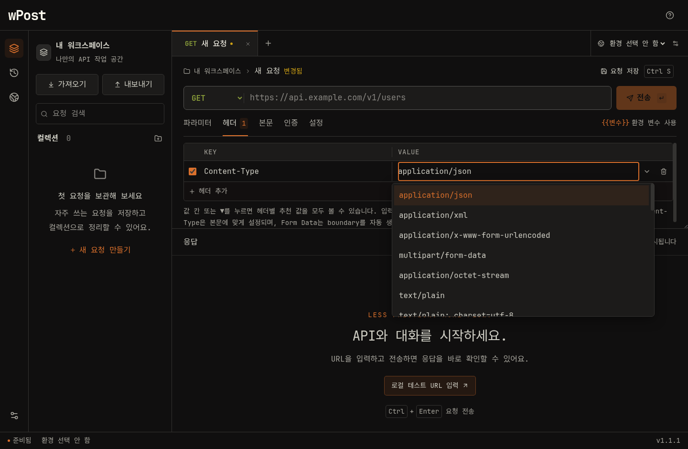

# wPost 1.1.1 Windows 빌드 · 2026-10-28

헤더 값 추천을 보완한 패치 릴리스다. `Content-Type` 등 값 칸 클릭·▼ 버튼으로 전체 후보를 열고, 입력으로 검색하며, 선택 후에도 다시 목록을 열 수 있다. 후보 8개 제한을 제거하고 단순 Tab 이동 시 기존 값이 바뀌는 문제를 방지한다. MIME 유형은 [IANA 등록 목록](https://www.iana.org/assignments/media-types)을 참고했다.

## 산출물

- 설치 파일: `release/1.1.1/wPost-1.1.1-x64-Setup.exe`
- 크기: **118,422,837바이트** (112.94 MiB)
- SHA-256: `e59dfce872c6246ac9366d3564e8d5ed906b3345eeb1f13e83623e8e1e95bcf9`
- 체크섬: 같은 경로의 `.exe.sha256` 파일.
- 소스 태그: `v1.1.1`; 릴리스 커밋 메시지: `Improve header value autocomplete in wPost 1.1.1`.
- [다운로드](https://github.com/parkhw328/wook-post/releases/latest/download/wPost-x64-Setup.exe) · [릴리스](https://github.com/parkhw328/wook-post/releases/tag/v1.1.1).

## 검증

- 기존 1.1.0에서 최초 값 목록에 `image/jpeg`가 없는 현상을 Electron 테스트로 재현했다. 변경 후 같은 시나리오를 통과했다.
- `npm run check`: TypeScript·Prettier·단위/통합 테스트 **49개 통과**.
- `xvfb-run -a -s '-screen 0 1600x1000x24' npm run test:e2e`: 프로덕션 빌드와 Electron UI **12개 통과**.
- 값 전체 목록, 클릭·▼로 재열기, 키보드 선택, 대소문자 구분 없는 검색, Content-Type/Accept/Cache-Control 전환, 직접 입력·환경 변수 보존, 1000×700 창에서 스크롤·선택을 확인했다.
- 기존 파일 업로드·저장·백업·가져오기·재실행 흐름도 통과했다. 의존성·저장 스키마·HTTP 전송 방식은 변경하지 않았다.
- Windows x64 NSIS 생성, 7-Zip 아카이브 검사 통과. 앱·설치기·ASAR 버전 `1.1.1`, 앱 x64 PE, 제작자·MIT 메타데이터를 확인했다.
- ASAR의 빌드 파일 9개와 아이콘·라이선스 원문이 소스의 SHA-256과 일치했다.
- 실제 Windows 설치·업그레이드·제거는 Linux에서 검증하지 않았으며 앱과 설치기는 미서명이다.

빌드 환경과 Docker 재현 명령은 [1.1.0 빌드 기록](v1.1.0-windows.md)의 절차를 사용하고 버전을 `1.1.1`로 바꾼다. Windows에서는 `npm ci` 후 `npm run dist:win`을 사용한다. `main`과 태그 푸시 후 `npm run release:publish`로 업로드·재다운로드 해시 검증·Latest 공개를 수행한다. 이전 로컬 산출물과 Git 태그는 보존한다.

