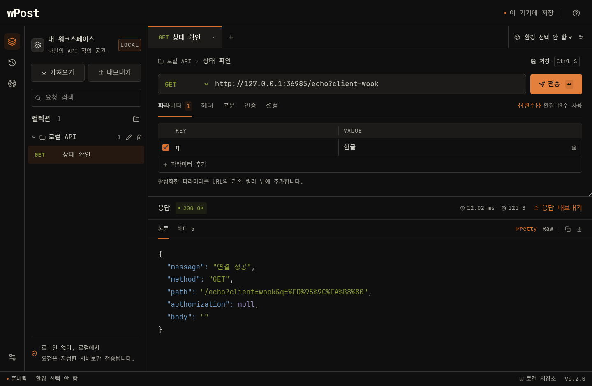

# 사용 안내

[문서 목록](README.md) · [프로젝트 홈](../README.md)

## 현재 기능

- GET, POST, PUT, PATCH, DELETE, HEAD, OPTIONS 및 중복 키를 지원하는 쿼리·헤더 편집.
- JSON, 텍스트, `application/x-www-form-urlencoded` 본문.
- Bearer Token / Basic Auth, `{{baseUrl}}` 형태의 환경 변수.
- 컬렉션에 요청 저장, 여러 탭, 검색, 요청 취소·시간 제한·리다이렉트 설정.
- 컬렉션 이름 변경·삭제, 삭제할 때 포함된 요청의 보존 여부 선택.
- 영문·한글 글꼴 선택, 요청·응답 글자 크기 80–150% 조절 (슬라이더·−/+ 버튼), 미리보기·취소·기본값 복원.
- 응답 상태·소요 시간·크기·헤더·JSON Pretty/Raw, 응답 복사와 원본 바이트 내보내기. JSON 정렬은 큰 정수·소수 표기·중복 키를 그대로 보존합니다.
- 로컬 SQLite 히스토리와 요청 재열기. 기록은 자동 삭제하지 않으며 100건씩 불러옵니다.
- 전체 백업, 히스토리, 단일 요청·응답 JSON 가져오기/내보내기.
- Postman Collection v2.0/v2.1 가져오기 및 v2.1 내보내기.

## 컬렉션과 화면 설정

컬렉션 이름 오른쪽의 **연필**로 이름을 바꾸고 **휴지통**으로 삭제합니다. 삭제 기본값은 요청을 **분류하지 않은 요청**으로 옮기는 방식입니다. **포함된 요청도 함께 삭제**를 선택하면 해당 컬렉션의 저장된 요청도 삭제합니다. 히스토리는 유지되며 함께 삭제한 요청의 열린 탭은 미저장 상태로 남아 다시 저장할 수 있습니다.

왼쪽 아래 **앱 설정**에서 영문 글꼴(JetBrains Mono·Consolas·Cascadia Code·Arial), 한글 글꼴(Noto Sans KR·맑은 고딕·돋움), 요청·응답 글자 크기(80–150%)를 슬라이더와 −/+ 버튼으로 조절합니다. 요청 URL·본문·입력 값, 응답 본문·헤더의 글씨 크기만 달라지고 메뉴·버튼·사이드바 크기는 유지됩니다. 변경은 즉시 미리 볼 수 있고 **설정 저장** 후 재실행해도 유지됩니다. 취소하거나 Esc로 닫으면 이전 설정으로 돌아갑니다. PC에 없는 글꼴은 번들 기본 글꼴로 대체합니다.

화면 설정은 이 PC의 SQLite에 별도로 보관하며 요청·히스토리 백업에는 포함하지 않습니다.

## 데이터 가져오기와 내보내기

사이드바의 **가져오기**에서 JSON을 선택합니다. 형식·건수·지원하지 않는 항목을 확인한 후 적용합니다. 기존 데이터는 유지하고 컬렉션·환경·요청을 새 ID로 추가합니다. 동일한 히스토리는 중복 저장하지 않습니다. 어느 항목이라도 적용에 실패하면 가져오기 전체를 되돌립니다.

**내보내기**에서 전체 백업 또는 히스토리를 선택합니다. 응답 영역에서는 단일 요청·응답 백업이나 원본 본문 파일을 저장할 수 있습니다. 원본 본문 파일은 JSON 백업과 달리 앱으로 다시 가져오는 형식은 아닙니다.

| 형식                                  | 보존 범위                                                                  |
| ------------------------------------- | -------------------------------------------------------------------------- |
| wPost JSON (`schemaVersion: 1`)       | 요청, 환경, 컬렉션, 요청·응답 기록, 원본 응답 바이트, 시간·크기            |
| Postman Collection v2.0/v2.1 가져오기 | 요청, 폴더 경로, 쿼리·헤더, raw/urlencoded 본문, Bearer/Basic, 컬렉션 변수 |
| Postman Collection v2.1 내보내기      | 저장한 요청, 컬렉션 폴더, 현재 활성 환경의 변수                            |

Postman 중첩 폴더는 요청 이름에 경로로 보존합니다. 스크립트는 실행하거나 가져오지 않으며 미리보기에 알립니다. multipart·파일 본문, Postman 경로 변수, OAuth 등 미지원 인증은 가져오기를 중단합니다. Postman 파일에는 wPost의 히스토리·타임아웃·리다이렉트 설정이 보존되지 않으므로 전체 이전은 wPost 백업을 사용하세요.

## 저장 위치와 한도

앱의 **정보** 화면에서 실제 데이터 경로를 확인할 수 있습니다. Windows 기본 경로는 `%APPDATA%/Wook Post/wook-post.sqlite`이며 설치 파일과 분리됩니다. wPost로 이름을 바꾼 뒤에도 기존 데이터를 이어 쓰도록 이 경로를 유지합니다. SQLite WAL 파일이 있을 수 있으므로 실행 중인 DB 파일을 직접 복사하기보다 앱의 백업 기능을 사용하세요.

- 토큰·비밀번호·쿠키·응답은 **평문**으로 로컬 저장소와 백업에 포함될 수 있습니다.
- 실행 기록에는 전송 시 치환한 환경 변수 값이 저장되어 환경 변경 후에도 같은 요청을 재사용할 수 있습니다.
- 요청 본문은 1 MiB, 수신 응답은 5 MiB까지입니다. 큰 응답은 부분 저장 사실을 화면과 백업에 표시합니다.
- 화면 본문 미리보기는 100,000자까지이며 저장된 원본은 파일로 내보낼 수 있습니다.
- 워크스페이스는 20 MiB, 백업 한 파일은 100 MiB / 히스토리 50,000건까지 지원합니다. 한도 초과 시 오류로 알리고 기존 데이터는 유지합니다.
- TLS 인증서를 검증합니다. 응답 HTML은 실행하지 않으며 클라우드 동기화·자동 업로드는 없습니다.
